

  

<h1 align="center">ورَّاق</h1>

<b>إحياء التراث بإخراجٍ يليق به</b>

برنامج Windows يحوّل كتب التراث وأبحاثك ومتونك إلى كتبٍ مُخرَجة كما تُطبع: 
يفهم المتن والشرح والحاشية، وينضّدها بأساليب دور النشر، ويخرجها PDF و Word مع غلافٍ جاهز للمطبعة.

  <a href="https://github.com/UNTURKI/warraq/releases/latest/download/Alwarraq-Setup.exe"><b>⬇ تنزيل ورَّاق لنظام Windows</b></a>
  &nbsp;·&nbsp; <a href="#التثبيت-خطوة-بخطوة">خطوات التثبيت</a>
  &nbsp;·&nbsp; <a href="#المميزات">المميزات</a>
  &nbsp;·&nbsp; <a href="#الأساليب">الأساليب</a>
  &nbsp;·&nbsp; <a href="#الأغلفة">الأغلفة</a>

  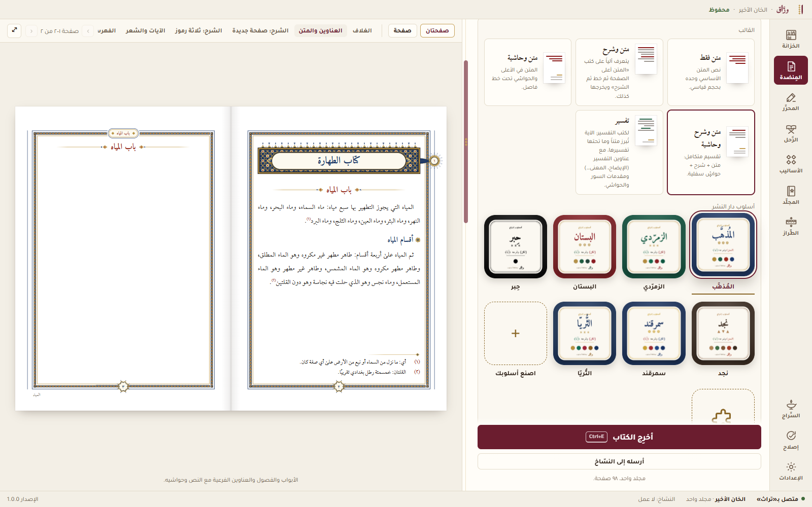

## ما الذي يميّزه؟

- **يفهم الكتاب لا يصفّه فقط:** يميّز العناوين والمتن والشرح والآيات والأحاديث والأبيات والحواشي، فيخرج كل نوع بتنسيقه.
- **كتابٌ جاهز من أول مرة:** اختر الكتاب والأسلوب والغلاف، ثم اضغط «أخرِج الكتاب».
- **لا يحتاج شيئًا غيره:** ملف واحد تثبّته، بلا Node.js ولا Word ولا أي برنامج جانبي.
- **عربي من أصله:** الواجهة والترقيم والتنضيد كلها مبنية للكتاب العربي.
- **بدون حساب وبدون إعلانات وبدون أدوات تتبّع:** كتبك وإعداداتك تبقى على جهازك.

## المميزات

### المنضدة: من الكتاب إلى الإخراج في خمس خطوات

الكتاب، ثم المجلدات، ثم التنضيد، ثم الغلاف، ثم الإخراج. والمعاينة صفحتين متقابلتين أمامك طوال الوقت.

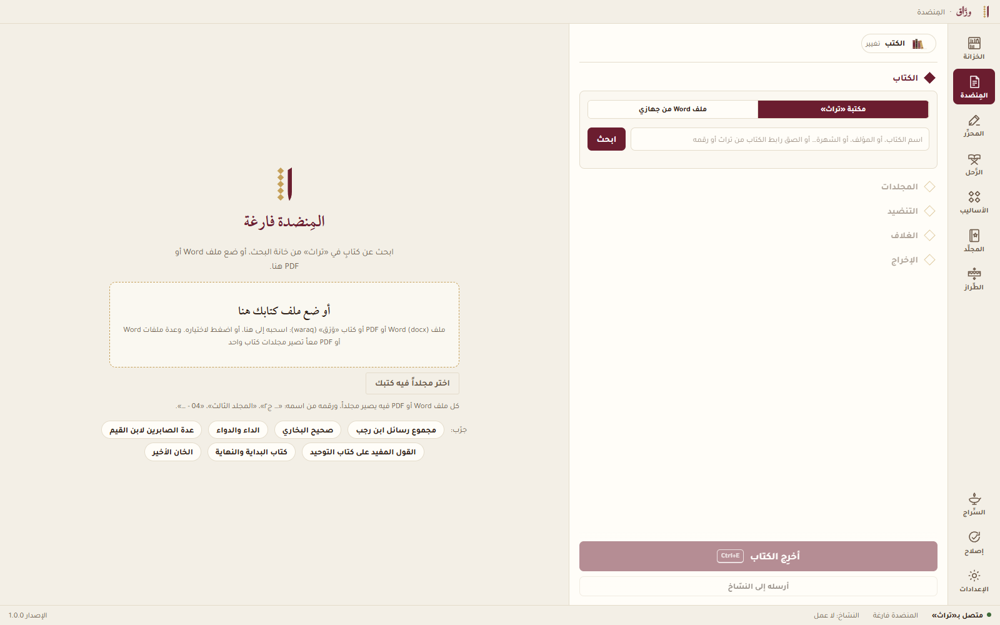

- **مصادر الكتب:** مكتبة «تراث»، و«المكتبة الشاملة» من مجلدها على جهازك بلا إنترنت، وملفات Word و PDF من جهازك.
- **ثلاثة أنواع من العمل:** الكتب، والأبحاث العلمية (صفحة العنوان والملخص والمباحث والمراجع)، والمتون (المتن وصفحة مسطرة مقابلة للتعليق).
- **القوالب:** متن فقط، متن وشرح، متن وحاشية، متن وشرح وحاشية، تفسير.
- **المجلدات:** يقسّم الكتاب كما في مصدره، وعدة ملفات Word أو PDF تصير مجلدات كتاب واحد.
- **إخراج نظيف:** ضبط الأسطر الوحيدة في أول الصفحة وآخرها، وأنماط الشعر، ورقم الصفحة الحقيقي.

### الإخراج: PDF و Word وكتاب «وَرَق»

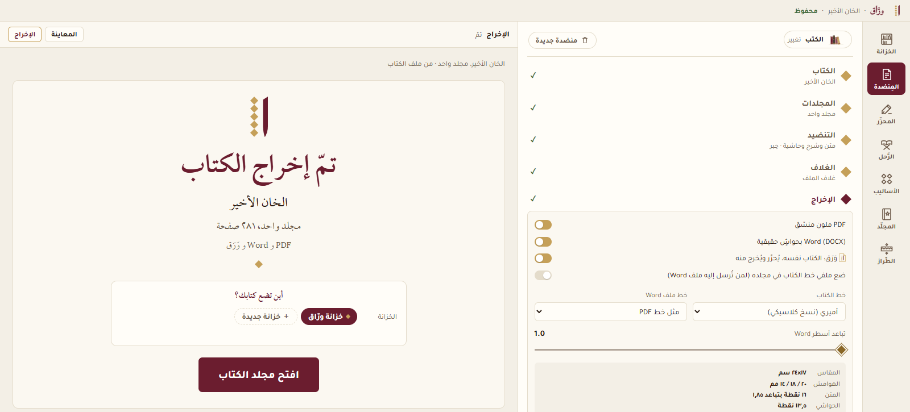

- **PDF** ملوّن ومنسّق بمحرك البرنامج المدمج.
- **Word** بحواشٍ حقيقية، تقدر تكمل تحريرها.
- **غلاف الطباعة** بالأمامي والخلفي والكعب، وعرض الكعب محسوب من عدد الصفحات ونوع الورق.
- **كتاب «وَرَق» (`.waraq`):** الكتاب بنصه وأسلوبه وتعديلاته في ملف واحد، يُفتح بنقرتين ويُخرج بلا اتصال.

### الخزانة: كتبك على رفوف حقيقية

كل كتاب تخرجه يوضع مجلّدًا بلون غلافه في خزانة خشبية، وتقدر ترتّبها في خزائن ومجموعات، وتفتحها أو تعيد إخراجها بضغطة.

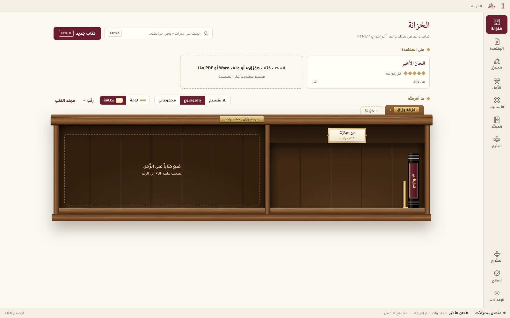

### المحرِّر: اكتب في صفحات الكتاب مباشرة

محرّر صفحات مثل Word و InDesign، ترى فيه الكتاب بصفحاته كما يخرج.

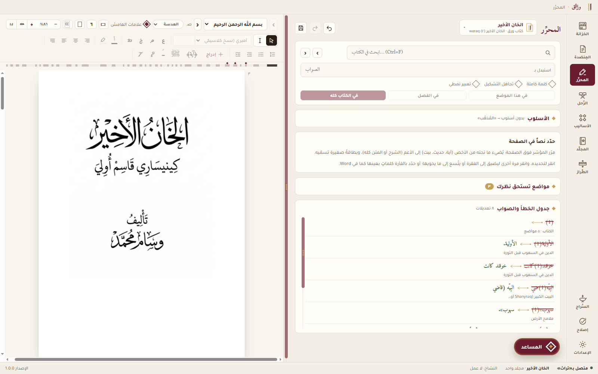

- الخط والفقرة والصور والجداول والقوائم والأنماط.
- مراجعة نوع كل مقطع: متن، شرح، آية، حديث، بيت، عنوان.
- بحث واستبدال في الموضوع أو الفصل أو الكتاب كله.
- **جدول الخطأ والصواب** يسجّل كل تعديل، مع الرجوع والإعادة.
- **المساعد:** ذكاء اصطناعي اختياري يعمل بمفتاحك أنت.

### الرَّحل: اقرأ واكتب على كتابك

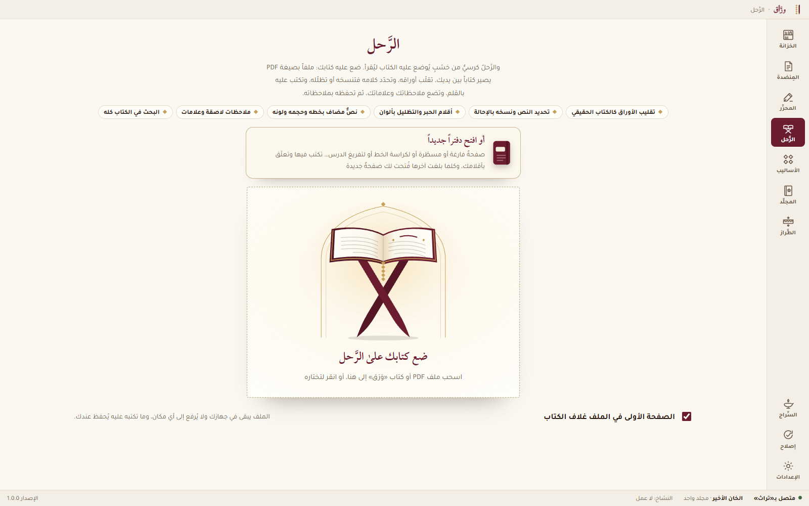

- تقليب الأوراق كالكتاب الحقيقي، وأقلام الحبر والتظليل بفُرَش وألوان.
- ملاحظات لاصقة وعلامات، ونسخ النص بالإحالة، وبحث في الكتاب كله.
- **الدفتر:** صفحات فارغة أو مسطرة لكراسة الخط أو تفريغ الدرس.
- **مجلس الدرس:** شاهد درسك من يوتيوب أو تيليجرام أو جهازك بجانب الكتاب، مع ملاحظات مرتبطة بوقت المقطع.

### الطِّراز: اجعل البرنامج على ذوقك

مودات تغيّر ألوان البرنامج وأصواته وحركته، أو تضيف له ما ليس فيه. ركّبها أو اصنعها بنفسك، ومعها وضع آمن يوقفها كلها.

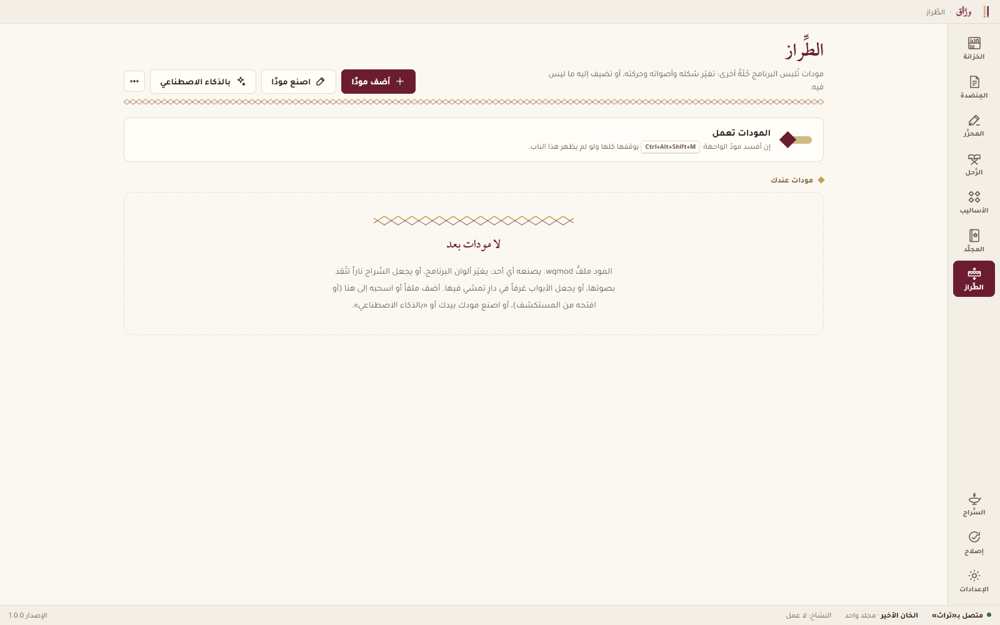

### وأيضًا

- **النسّاخ:** أرسل الكتاب ليُخرَج في الخلفية وأكمل عملك، ويستأنف الطابور بعد إعادة التشغيل.
- **السِّراج:** وضع ليلي بالذهب واللازورد.
- **القلم (Ctrl+K):** وصول سريع لأوامر البرنامج.
- **خطوط جهازك:** كل خط مثبّت في Windows يظهر في قوائم الخطوط.
- **ربط بالنظام:** افتح ملفات `.waraq` بنقرتين، وأخرج ملفات Word و PDF من قائمة الزر الأيمن.

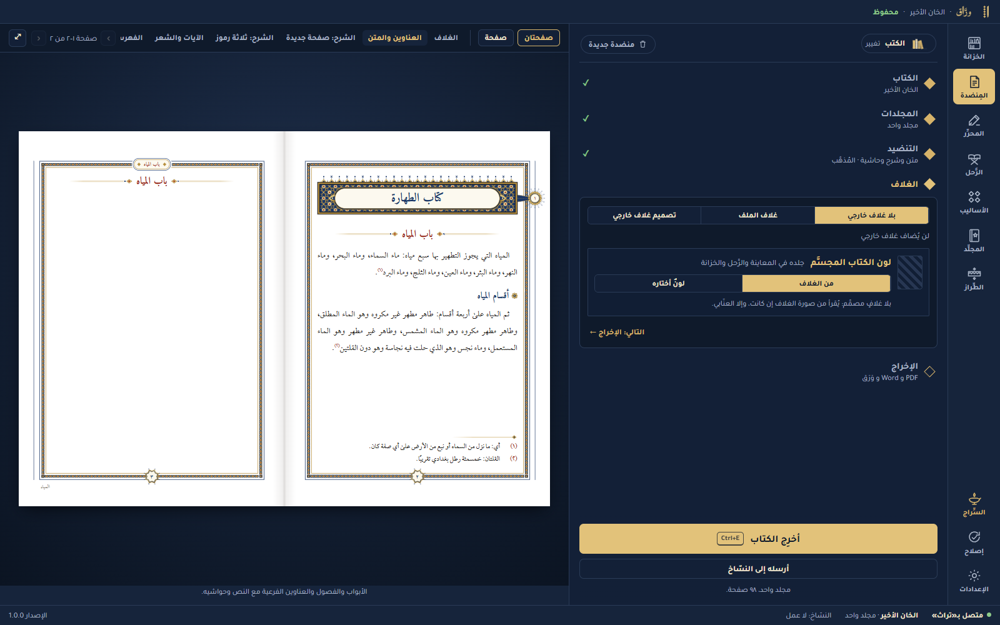

## الأساليب

سبعة أساليب مضمّنة، ولكل واحد زخارفه وخطوطه وألوانه. وتقدر تعدّلها، أو تصنع أسلوبك بالنقر بلا كود، أو تركّب بطاقة أسلوب جاهزة.

<table>
<tr>
<td align="center">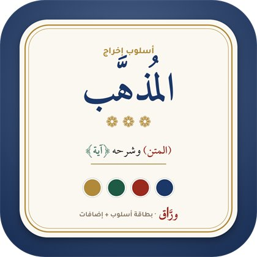 <b>المُذهَّب</b></td>
<td align="center">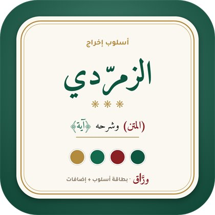 <b>الزمرّدي</b></td>
<td align="center">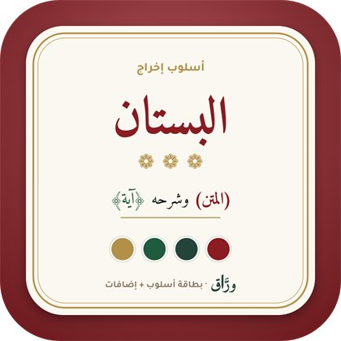 <b>البستان</b></td>
<td align="center">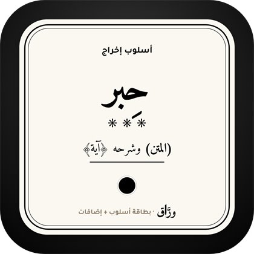 <b>حِبر</b></td>
</tr>
<tr>
<td align="center">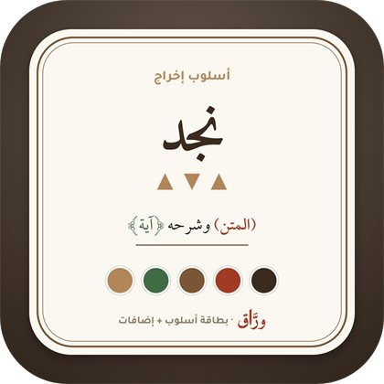 <b>نجد</b></td>
<td align="center">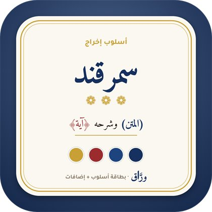 <b>سمرقند</b></td>
<td align="center">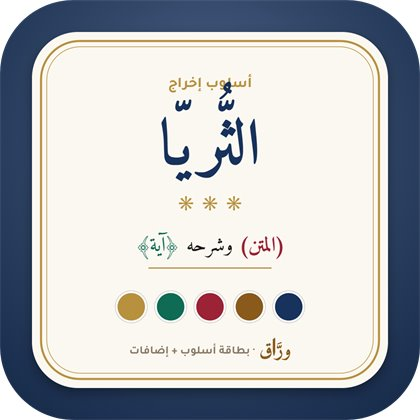 <b>الثُّريّا</b></td>
<td></td>
</tr>
</table>

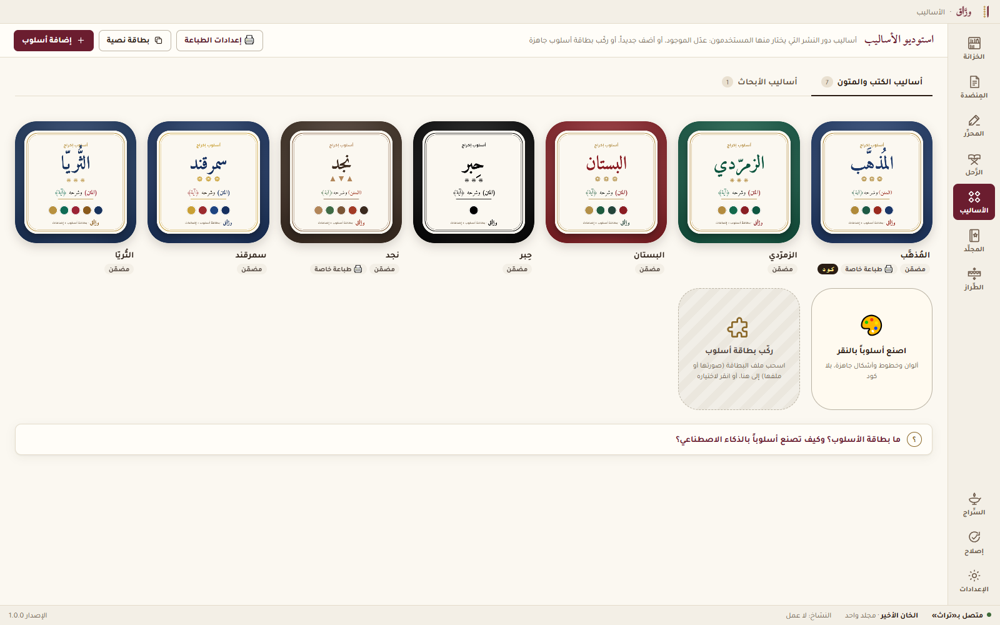

## الأغلفة

خمسة تصاميم جاهزة، لكل واحد غلاف أمامي وكعب وخلفي. تختار التصميم، فيكتب البرنامج اسم الكتاب والمؤلف ورقم المجلد في مواضعها، ويحسب عرض الكعب من عدد الصفحات ونوع الورق، ثم يخرج لك ملف **غلاف الطباعة** مفرودًا كما تراه هنا: الأمامي، فالكعب، فالخلفي.

والصور أدناه مرسومة بمحرك البرنامج نفسه، بأسماء كتب للتمثيل.

### الورَّاق

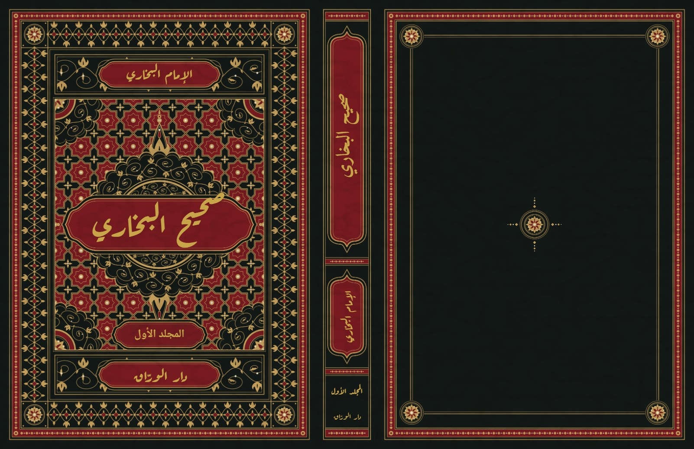

### الزُّمُرُّد

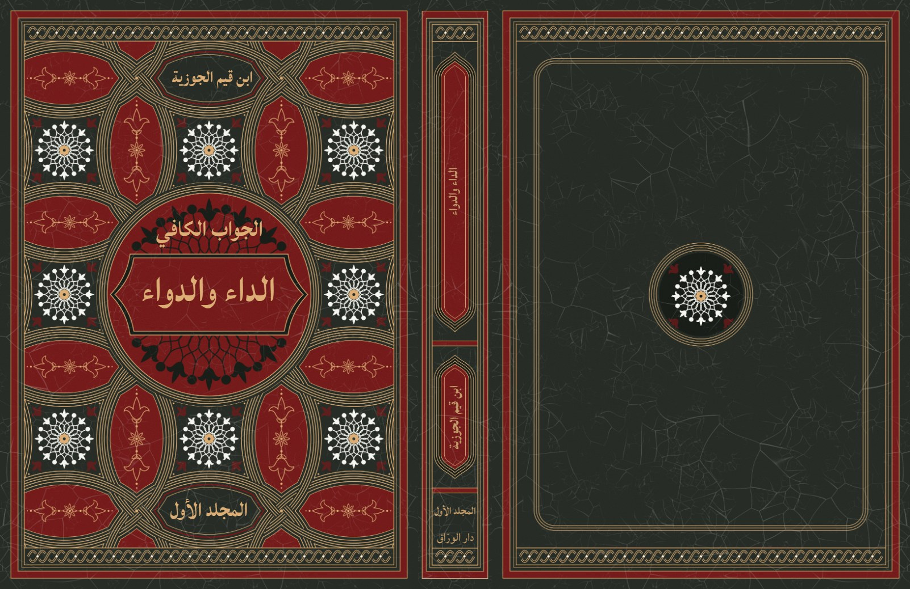

### البُستَان

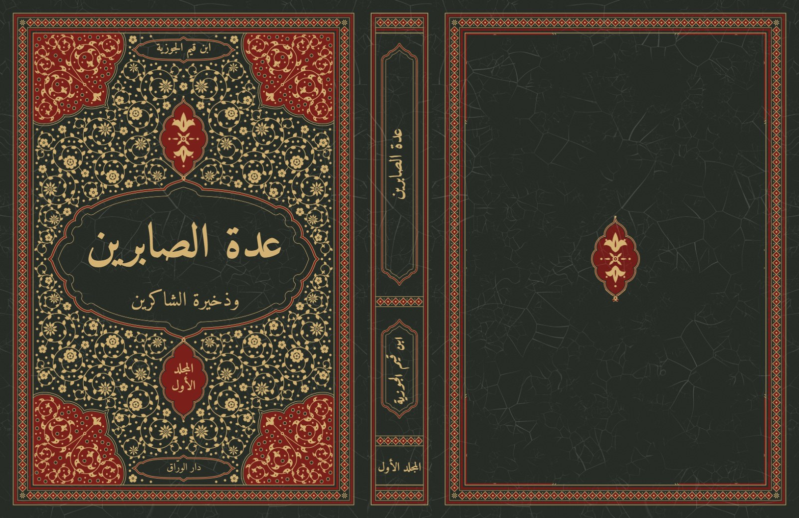

### تَشكِيل

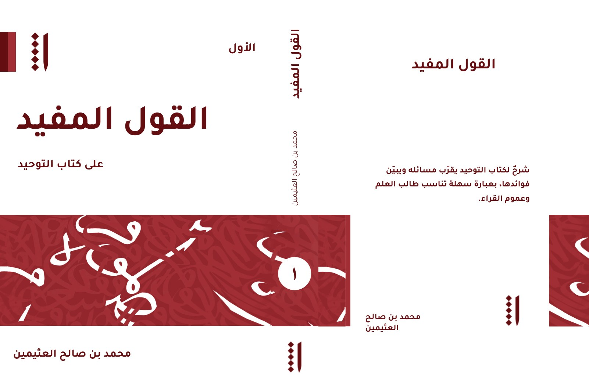

### رِوَاق

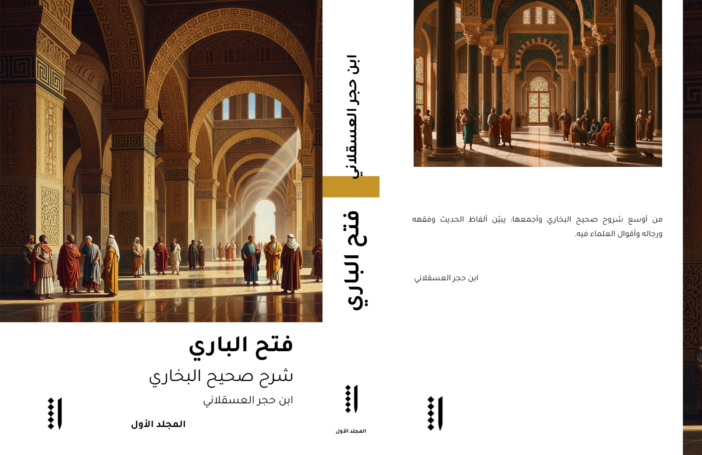

### الحزم الجاهزة

ثلاث حزم تختار الأغلفة الثلاثة والأسلوب المناسب لها دفعة واحدة: **الورَّاق** مع أسلوب المُذهَّب، و**الزُّمُرُّد** مع الزمرّدي، و**البُستَان** مع البستان. وألوان الأمامي مربوطة بالخلفي والكعب، فتتغير معًا في الحزم التي رُبطت فيها.

ومع «المجلِّد» تصمّم غلافك بنفسك: طبقات وصور وألوان وخطوط.

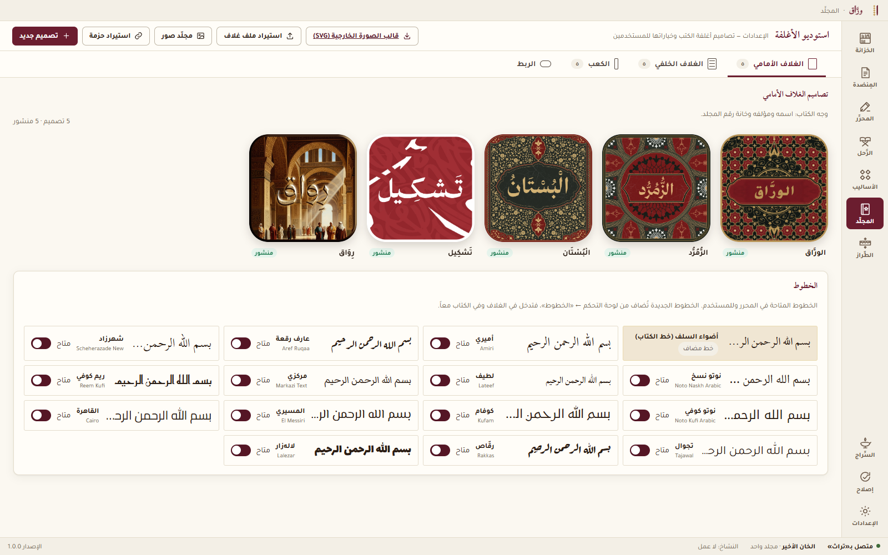

## التثبيت خطوة بخطوة

**المتطلبات:** Windows 10 أو 11 (64-بت)، ومساحة نحو 1 جيجابايت. الإنترنت مطلوب لجلب الكتب من «تراث» فقط.

### ١. نزّل الملف

- الطريق المباشر: [اضغط هنا لتنزيل `Alwarraq-Setup.exe`](https://github.com/UNTURKI/warraq/releases/latest/download/Alwarraq-Setup.exe) (نحو 280 م.ب).
- أو من صفحة [الإصدارات](https://github.com/UNTURKI/warraq/releases/latest): انزل إلى قسم **Assets** واضغط على الملف `Alwarraq-Setup.exe`.
- **التحديث:** من الإصدار 1.0.1 فأحدث، يخبرك البرنامج عند التشغيل إذا صدر إصدار جديد، فينزّله ويثبّته بإذنك، وتبقى كتبك وإعداداتك كما هي. وتتحقق بنفسك من **الإعدادات ← التحديثات**.

> **لا تنزّل** «Source code»، فهو الكود المصدري وليس البرنامج.

### ٢. شغّل الملف

افتح الملف من مجلد التنزيلات. قد يظهر تنبيه Windows الأزرق «Windows protected your PC» لأن الملف غير موقّع رقميًا بعد:

1. اضغط **More info** (مزيد من المعلومات).
2. اضغط **Run anyway** (تشغيل على أي حال).

وإذا نبّهك المتصفح عند التنزيل، اختر **Keep** (الاحتفاظ).

### ٣. ثبّت البرنامج

سيطلب Windows **صلاحية المدير**: وافق عليها بالضغط على **Yes** (نعم)، فالمثبّت يحتاجها ليضع البرنامج في `Program Files` ويثبّت خطوطه لكل حسابات الجهاز. ثم اضغط **تثبيت**، وتقدر تغيّر مكان التثبيت قبلها.

إذا كان الجهاز ليس باسمك، يحتاج التثبيت كلمة مرور حساب مدير. والبرنامج نفسه يعمل بعدها بصلاحياتك العادية.

<table>
<tr>
<td align="center">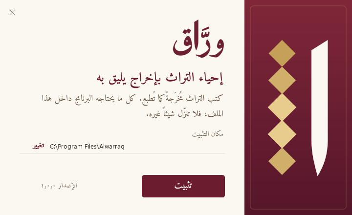 الترحيب</td>
<td align="center">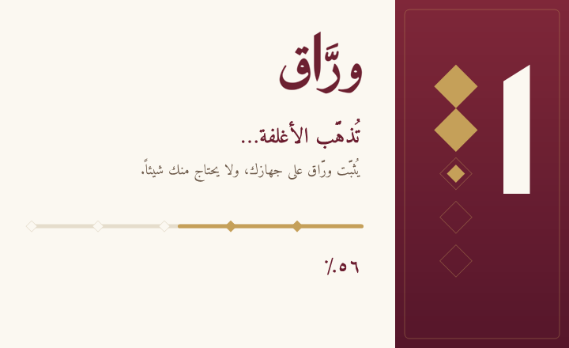 النقاط الخمس مع التقدم</td>
<td align="center">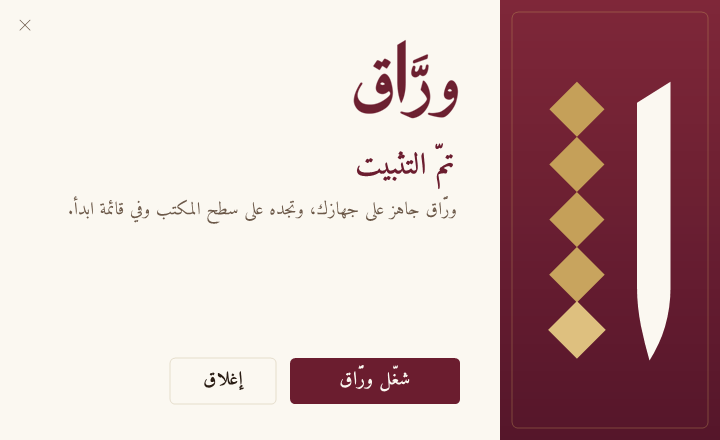 جاهز</td>
</tr>
</table>

### ٤. ابدأ

اضغط **شغّل ورَّاق**، وستجده بعدها على سطح المكتب وفي قائمة ابدأ. ثم من «المنضدة» اختر «الكتب» وجرّب أحد الكتب المقترحة:

مجموع رسائل ابن رجب · صحيح البخاري · الداء والدواء · عدة الصابرين · القول المفيد على كتاب التوحيد · البداية والنهاية · الخان الأخير

### إلغاء التثبيت

من إعدادات Windows ← **التطبيقات** ← **ورَّاق** ← **إلغاء التثبيت**. وتبقى كتبك في مجلد المستندات.

## الخصوصية

- لا حساب، ولا إعلانات، ولا أدوات تتبّع.
- يتصل البرنامج بالإنترنت لما تطلبه: جلب الكتب من «تراث»، وخطوط Google عند الحاجة، والخدمات الاختيارية التي تفعّلها بنفسك مثل الذكاء الاصطناعي بمفتاحك.
- الملاحظات لا تُرسل إلا إذا اخترت إرسالها.

## للمطوّرين

يحتاج Node.js على جهاز المطوّر فقط.

| الملف | ما يفعله |
|---|---|
| `run-dev.bat` | تشغيل البرنامج للتطوير |
| `build-setup.bat` | بناء المثبّت `dist/Alwarraq-Setup-<version>.exe` |
| `publish-update.ps1` | نشر إصدار جديد: يبني المثبّت ويرفعه، فيعرضه البرنامج على مستخدميه |
| `build-store.bat` | بناء حزمة متجر مايكروسوفت |

مبني على Electron، والتفاصيل التقنية الكاملة في [اقرأني.md](اقرأني.md).

## التواصل

- البريد: [faqeeh.university@gmail.com](mailto:faqeeh.university@gmail.com)
- X: [@UN_TURKI](https://x.com/UN_TURKI)
- وجدت خللًا أو عندك فكرة؟ افتح [Issue](https://github.com/UNTURKI/warraq/issues).

---

الكتب من مكتبة <a href="https://app.turath.io">«تراث»</a>. وصور الصفحات أعلاه من البرنامج نفسه، ومعاينة الأساليب فيها على نص تجريبي.

